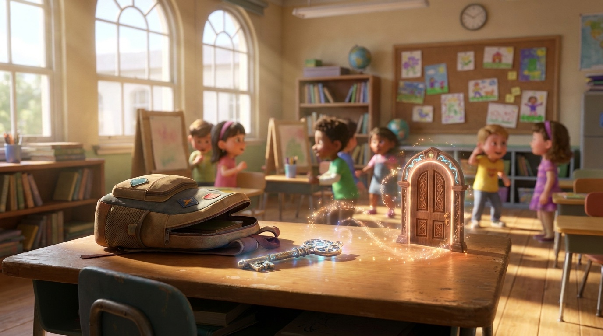
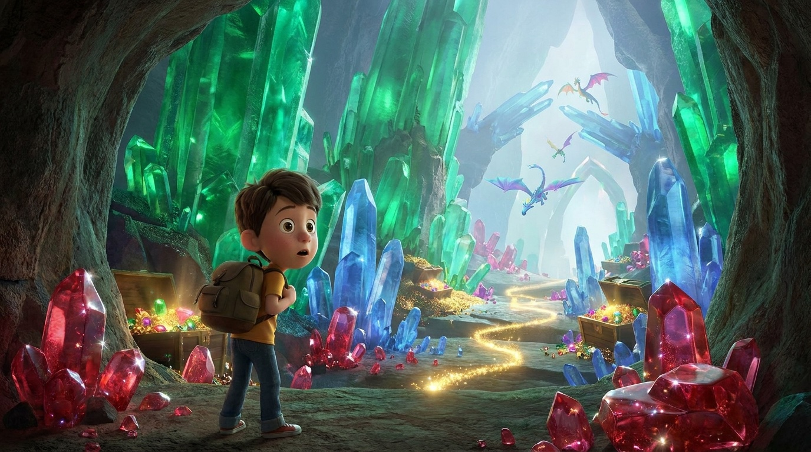
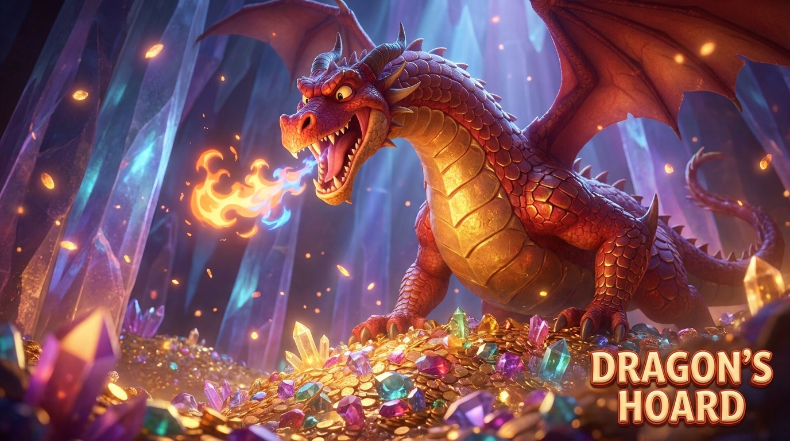
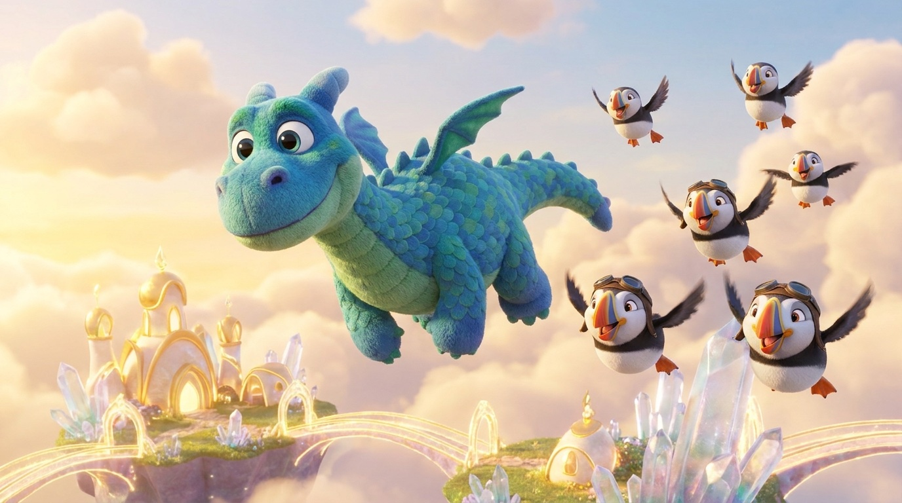

# 🎒🐉🐧 La Storia dello Zaino Magico, del Drago e dei Puffins

> **Una storia originale inventata e raccontata al microfono da Alessandro C. (8 anni, Primary 3) con papà Riccardo.**  
> *Registrata il 6 Novembre 2026 a Zurigo.*

---

## 🎙️ Ascolta la Storia Raccontata da Alessandro

* **Formato MP3**: [audio_originale.mp3](audio_originale.mp3)
* **Formato OGG (Opus)**: [audio_originale.ogg](audio_originale.ogg)
* **Archivio audio globale**: `audio/alessandro/2026-11-06-storia-zaino-drago-puffins.mp3`

---

## 📝 Sbobinatura Fedele (Audio Transcript)

Ecco la trascrizione integrale del messaggio vocale registrato al microfono:

> **Papà Riccardo:**  
> «Ecco, ciao Ermete, buongiorno! Alessandro ha inventato una storia fighissima di uno zaino di una scuola... ti chiederei, adesso Ale te la racconta e quando ha finito tu usi il nuovo modello Gemini Omni... per fare un video di questa storia. Vai Ale!»
>
> **Alessandro:**  
> «Una volta c'era un zaino... c'era un tizio che non mi ricordo com'era il suo nome, ma ha trovato un zaino e dentro il zaino ha trovato una chiave. E poi non ha potuto vedere nessuna parte dove entrare con quella chiave.  
> Prossimo giornata all'altro break ha visto una porta sul suo desk e ci ha entrato ed è andato nel mondo dei draghi che era fatto di gemme!  
> E poi lui ha preso tantissime gemme e poi c'è un drago, un grandissimo drago che ha detto: *"No, tu non puoi prenderle, sono mie!"*  
> E il ragazzo ha detto: *"No, ora sono mie!"*  
> E poi il drago ha sputato fuoco e l'ha fritto! E poi l'ha mangiato!  
> E poi ha preso le gemme indietro e ha preso la chiave ed è andato con i suoi amici all'altro mondo fatto di oro e cristalli dove ha potuto vedere gli altri dei suoi amici.»
>
> **Papà Riccardo:**  
> «E cos'erano altri suoi amici? Erano altri draghi?»
>
> **Alessandro:**  
> «No, erano **PUFFINS**!»
>
> **Papà Riccardo:**  
> «Erano dei puffins?!»
>
> **Alessandro:**  
> «Sì!»
>
> **Papà Riccardo:**  
> «Quindi il drago era amico dei puffins?!»
>
> **Alessandro:**  
> «Sì!»
>
> **Papà Riccardo:**  
> «Ok, è finita la storia amore?»
>
> **Alessandro:**  
> «Sì!»

---

## 📖 Il Racconto Illustrato

### Capitolo 1: La Chiave nello Zaino e la Porta sul Banco
C'era una volta un ragazzo che trovò uno zaino misterioso. Aprendolo, dentro trovò un'antica chiave dorata incisa con simboli magici. Provò a capire a cosa servisse, ma a casa non c'era nessuna serratura compatibile.
Il giorno seguente a scuola, durante la pausa tra una lezione e l'altra (*all'altro break*), accadde qualcosa di incredibile: **sul piano di legno del suo banco comparve una porticina magica luminosa!**

---

### Capitolo 2: Nel Mondo Scintillante dei Draghi
Infilata la chiave nella serratura della porticina, il ragazzo la aprì e la attraversò, ritrovandosi catapultato nel leggendario **Mondo dei Draghi**.
Era un luogo da togliere il fiato: caverne immense fatte interamente di gemme preziose, pilastri di ametista, stalagmiti di zaffiro e pianure di rubini e smeraldi sfavillanti. Incantato da tutto quel tesoro, il ragazzo cominciò a riempirsi le tasche!

---

### Capitolo 3: "No, sono mie!" — Il Furore del Grande Drago
D'improvviso la terra tremò e dalle rocce cristalline emerse un drago maestoso, gigante, con scaglie rosse e dorate fiammeggianti.
Il Drago ruggì:
> *«No! Tu non puoi prenderle, sono mie!»*

Ma il ragazzo non si fece intimorire e ribatté:
> *«No! Ora sono mie!»*

Il Drago spalancò le fauci e... *FWOOOOOOSH!* Sputò un torrente di fuoco che lo arrostì all'istante in stile cartone animato e lo mangiò in un boccone! Il drago si riprese le sue preziose gemme, recuperò la chiave dorata e spiegò le grandi ali per partire verso la sua vera casa.

---

### Capitolo 4: Il Grande Twist — I Migliori Amici del Drago sono i Puffins!
Volando oltre i confini del mondo di gemme, il drago usò la chiave per aprire il passaggio verso un regno favoloso sospeso nel cielo, fatto di torri d'oro e isole fluttuanti di puro cristallo.
Lì ad attenderlo non c'erano mostri o altri draghi spaventosi... ma **uno stormo di allegrissimi PUFFINS (pulcinelle di mare)** con i loro becchi colorati d'arancio e giallo e occhialini da aviatore! Il drago guardiano delle gemme, in fondo, aveva un cuore d'oro ed era il migliore amico delle pulcinelle di mare!

---

## 🎬 Il Video Ufficiale da 40 Secondi (Gemini Omni Flash)

Il film animato completo in **4 atti da 10 secondi (40 secondi totali)** racconta **tutta la storia dall'inizio alla fine** con narrazione e dialoghi in italiano, partendo dalle 4 illustrazioni della storia tramite **Gemini Omni Flash** (`gemini-omni-flash-preview`):

* 📹 **File Video**: [video_drago_puffins.mp4](video_drago_puffins.mp4)
* **Specifiche**: 1280x720 (16:9), H.264 / AAC 48kHz stereo, **40 secondi** (4 atti × 10s: Banco & Chiave → Mondo delle Gemme → Fiammata del Drago → Volo con i Puffins).

---

## 🌐 Pagina Web Interattiva
È disponibile la versione completa sfogliabile con audio player e video incorporato in:
* **HTML**: [index.html](index.html)
