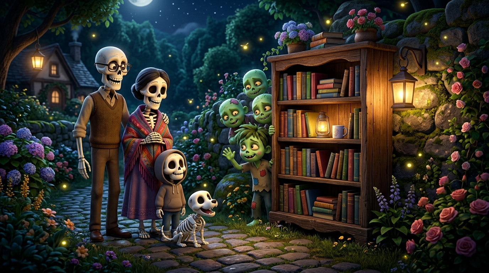
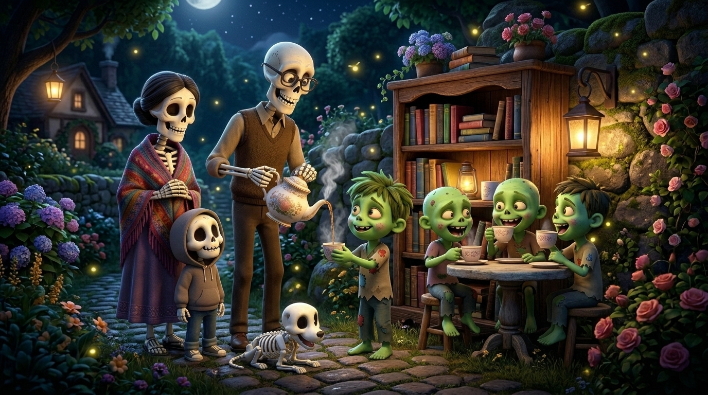
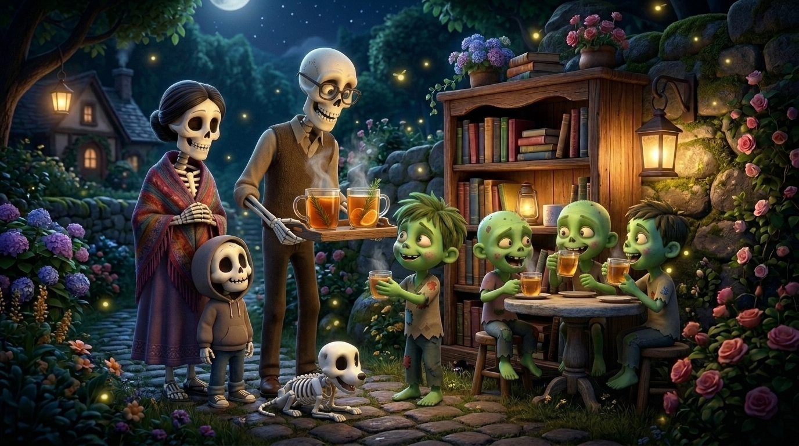

# 💀🧟☕ La Famiglia di Scheletri e gli Zombie Assetati di Tè

> **Una storia originale inventata e raccontata al microfono da Alessandro C. (8 anni, Primary 3) con papà Riccardo.**  
> *Registrata il 4 Novembre 2026 a Zurigo.*

---

## 🎙️ Ascolta la Storia Raccontata da Alessandro

* **Formato MP3**: [audio_originale.mp3](audio_originale.mp3)
* **Formato OGG (Opus)**: [audio_originale.ogg](audio_originale.ogg)
* **Audiolibro Narrato (🇮🇹 Italiano + Piano)**: [narrated_it.mp3](narrated_it.mp3)
* **Narrated Audiobook (🇬🇧 English + Piano)**: [narrated_en.mp3](narrated_en.mp3)
* **Archivio audio globale**: `audio/alessandro/2026-11-04-storia-scheletri-zombie-te.mp3`

---

## 📝 Sbobinatura Fedele (Audio Transcript)

Ecco la trascrizione integrale parola-per-parola del messaggio vocale registrato al microfono:

> **Papà Riccardo:**  
> «Pux, mio figlio Alessandro ha una storia da raccontarti, una storia che si è inventato. Ti chiederei di ascoltare tutta la storia di Ale, poi dopo quando l'hai ascoltata la trascrivi, poi la mettiamo da qualche parte che ti dirò, e poi generi un'immagine... Vai Ale, raccontaci la storia numero due!»
>
> **Alessandro:**  
> «Ehm... questa storia è di... dei scheletri, una famiglia di scheletri con un cane scheletro.  
> Una volta hanno voluto andare nel buio buio giardino. Nel buio buio giardino c'era un buio buio...»
>
> **Papà Riccardo:** *(sussurra)*  
> «...intenso...»
>
> **Alessandro:**  
> «...intenso! E c'era ehm... un... un... una libreria! E dentro la libreria c'erano tantissimi zombie, zombie che hanno chiesto gentilmente per una... un po' di tè!  
> E poi i scheletri hanno andato indietro a casa, ha preso un tè, e poi li ha dato a i zombie.  
> I zombie ne ha voluto di più di tè, e più! E poi hanno andato...»
>
> **Papà Riccardo:**  
> «Il tè intendi il tè da bere hanno voluto? Ok, hanno voluto più tè!»
>
> **Alessandro:**  
> «Sì! E poi hanno andato a casa, questa volta hanno preso due bicchieri di tè.  
> Poi i zombie li ha beve- bevuti e hanno chiesto: *"Grazie!"*  
> E poi i scheletri hanno chiesto: *"Vuoi un'altra cosa?"*  
> E poi i zombie hanno detto: *"Sì!"*  
> **Finita!**»

---

## 📖 Il Racconto Illustrato (del Cantastorie)

### Capitolo 1: La Passeggiata nel Buio Buio Giardino e la Libreria Segreta

---

### Capitolo 2: La Corsa a Casa e la Prima Teiera Fumante

---

### Capitolo 3: Due Bicchieri di Tè e un "Grazie!" di Cuore

---

## 🌐 Pagina Web Interattiva
È disponibile la versione sfogliabile con audiolibro IT/EN e voce originale in:
* **HTML**: [index.html](index.html)
