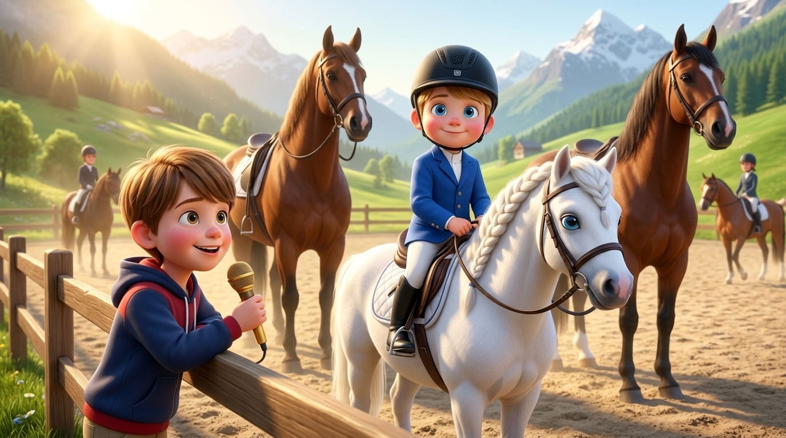
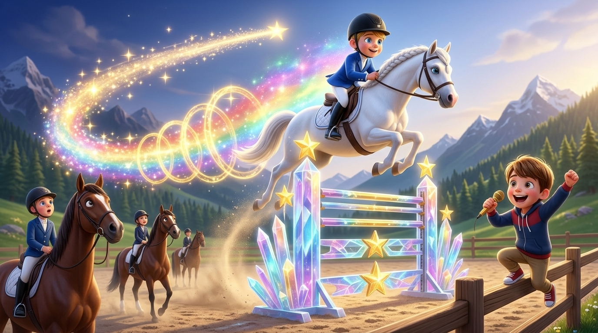
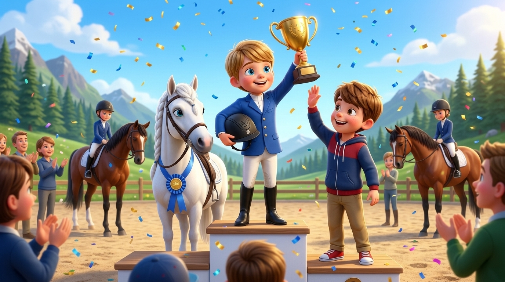
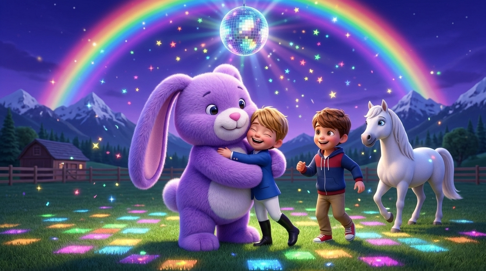

# 🏆🐴🌈 Sebi, il Campione del Pony Club alla Velocità della Luce e il Disco Party con Pupurabbu

> **Una storia originale inventata e raccontata a voce da Alessandro C. ("Ale", 8 anni, Primary 3) per il fratellino Sebastian ("Sebi", 6 anni, Primary 1) insieme a papà Riccardo.**  
> *Registrata l'8 Novembre 2026 a Zurigo.*

---

## 🎙️ Ascolta la Registrazione Vocale Originale e l'Audiolibro Narrato

* **Audiolibro Narrato (Italiano, Voce + Pianino)**: [narrated_it.mp3](narrated_it.mp3)
* **Audiolibro Narrato (British English `en-GB`, Voice + Piano)**: [narrated_en.mp3](narrated_en.mp3)
* **Registrazione Vocale Originale di Alessandro (MP3)**: [audio_originale.mp3](audio_originale.mp3)
* **Registrazione Vocale Originale di Alessandro (OGG)**: [audio_originale.ogg](audio_originale.ogg)
* **Archivio audio globale**: `audio/alessandro/2026-11-08-sebi-campione-pony-club.mp3`

---

## 📝 Sbobinatura Fedele (Audio Transcript)

Ecco la trascrizione integrale e fedele parola-per-parola del messaggio vocale registrato da Alessandro insieme a papà Riccardo:

> **Papà Riccardo:**  
> «Ermete, Alessandro qui ha una storia per te. Vai! Vai Ale.»  
>  
> **Alessandro:**  
> «Una volta c'era Sebi e è andato a Pony Club, e era il più veloce di tutti! Era così veloce che andava... ehm... con i grandissimi cavalli! Era così... ehm... forte e coraggioso! E andava... ehm... a competire...»  
>  
> **Papà Riccardo:**  
> «A fare competizione.»  
>  
> **Alessandro:**  
> «...competizione dei salti che non ha mai provato da fare! Ma poi, quel giorno, era il primo! Era così veloce che nessuno l'ha potuto vedere! Era **velocità della luce**, e era velocissimo e bravissimo! Era il primo di tutta la Pony Club!»  
>  
> **Papà Riccardo:**  
> «Wow! Devi metterci degli elementi un po' fantasy, degli elementi interessanti della storia... per ora hai solo detto che ha fatto molto...»  
>  
> **Alessandro:**  
> «Poi alla... alla... ehm... *end*, c'è un... una celebrazione per Sebi, come che fanno la **disco party**, e sì, e poi c'è un **rainbow**, **Regenbogen**, e c'è anche **Pupurabbu grandissimo** che lo abbraccia e dice: *"Wow, Sebi, sei grande!"* Eee... sì...»  
>  
> **Papà Riccardo:**  
> «Quando hai finito puoi chiedere?»  
>  
> **Alessandro:**  
> «**Finito!**»

---

## 📖 Il Racconto Illustrato (narrato dal fratello maggiore Alessandro)

### Capitolo 1: Sebi al Pony Club tra i Grandissimi Cavalli (e il tifo di Ale!)

C'era una volta una splendida mattina di sole al **Pony Club** di Zurigo. A bordo campo, appoggiato alla staccionata di legno con un microfono dorato da cronista ufficiale e gli occhi nocciola che brillavano d'orgoglio, c'era il fratello maggiore **Alessandro ("Ale")**, pronto a raccontare al mondo intero l'impresa più leggendaria di sempre: quella del suo fratellino **Sebi**!

Sebi, con i suoi ciuffi biondo scuro sotto il caschetto blu e i grandi occhi azzurri pieni di grinta, era salito in sella al suo candido pony bianco. Non aveva paura di nulla: invece di restare nel recinto dei piccoli, si era schierato sulla linea di partenza fianco a fianco con i **grandissimi cavalli** da corsa, destrieri giganti e muscolosi alti il doppio di lui! «Forza Sebi, sei il più forte e coraggioso di tutti!» gridò Ale al microfono, dando il via alla grande competizione.

---

### Capitolo 2: Il Salto Mai Provato e la Velocità della Luce!

Davanti ai concorrenti si stagliavano ostacoli altissimi e scintillanti, salti acrobatici così vertiginosi che Sebi non aveva mai nemmeno provato ad affrontare prima di quel giorno. Ma non appena suonò la campana di partenza, accadde qualcosa di prodigioso!

Sebi strinse le redini e partì così forte da superare il vento: galoppava alla **velocità della luce**! Era talmente veloce che nessuno sugli spalti riusciva quasi a vederlo ad occhio nudo: si scorgeva soltanto una folgorante scia dorata di stelle e scintille supersoniche che spiccava il volo sopra l'ostacolo più alto del campo! «Incredibile! Va alla velocità della luce, nessuno riesce a vederlo!» esultava Ale saltando di gioia lungo la staccionata, mentre i grandissimi cavalli guardavano a bocca aperta quel piccolo cavaliere biondo volare nel cielo.

---

### Capitolo 3: Il Primo Assoluto di Tutto il Pony Club!

Con un atterraggio perfetto degno di un vero campione, Sebi tagliò il traguardo lasciandosi dietro una nuvola di polvere di stelle. Il tabellone luminoso non lasciava dubbi: era **il primo classificato di tutto il Pony Club**!

Al centro dell'arena venne allestito il grande podio d'onore. Sebi salì sul gradino più alto accanto al suo inseparabile pony bianco e sollevò al cielo la gigantesca Coppa d'Oro dei Campioni sotto una pioggia di coriandoli scintillanti. Il fratello maggiore Ale corse subito sotto il podio per battergli un cinque fortissimo, mentre persino i grandissimi cavalli si inchinavano con rispetto davanti al piccolo grande campione.

---

### Capitolo 4: Disco Party, Regenbogen e l'Abbraccio di Pupurabbu Gigante!

Ma come racconta sempre Ale, alla *end* di ogni grande impresa ci vuole una festa fantasy indimenticabile! Appena calò il crepuscolo, il Pony Club si trasformò in una sfavillante **Disco Party** all'aperto: una grande palla stroboscopica a specchi prese a roteare a mezz'aria e nel cielo spuntò un magico arcobaleno luminoso — un vero **Rainbow**, anzi, un **Regenbogen**!

E proprio sotto il ponte dell'arcobaleno arrivò l'ospite d'onore più atteso: un **Pupurabbu grandissimo**, il dolce coniglio di peluche viola dalle lunghe orecchie color lavanda, diventato alto e soffice come una nuvola! Pupurabbu spalancò le sue morbide zampe, strinse Sebi in un abbraccio gigantesco sotto le luci della discoteca e gli disse con voce affettuosa: **«Wow, Sebi, sei grande!»** Ale ballava felice insieme a loro e, sorridendo al microfono, chiuse la sua storia con la parola più bella: **«Finito!»**

---

## 🎬 Il Video Ufficiale (40 Secondi — 4 Atti × 10s)

* **Film Animato 40s (MP4 720p HD, Narrato in Italiano)**: [video_sebi_campione_pony_club.mp4](video_sebi_campione_pony_club.mp4)
* **Anteprima Hover 5s**: [hover_preview.mp4](hover_preview.mp4)
* **Pagina Web Interattiva**: [index.html](index.html)
