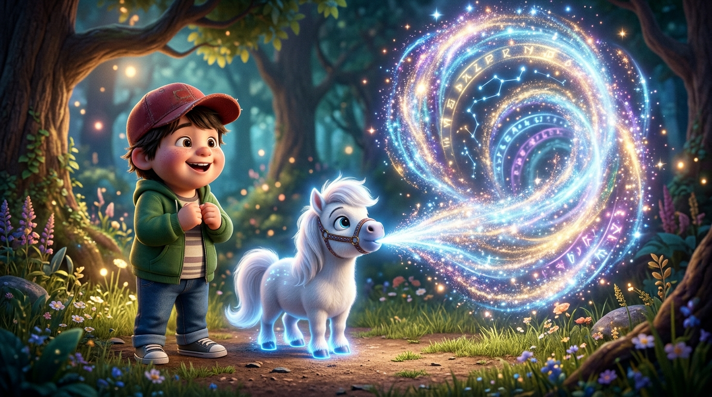
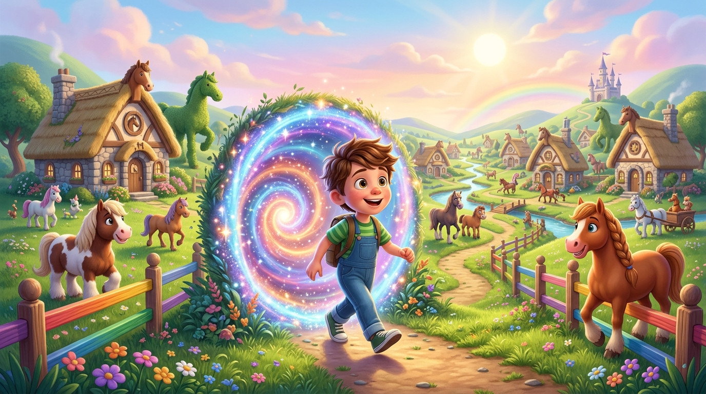
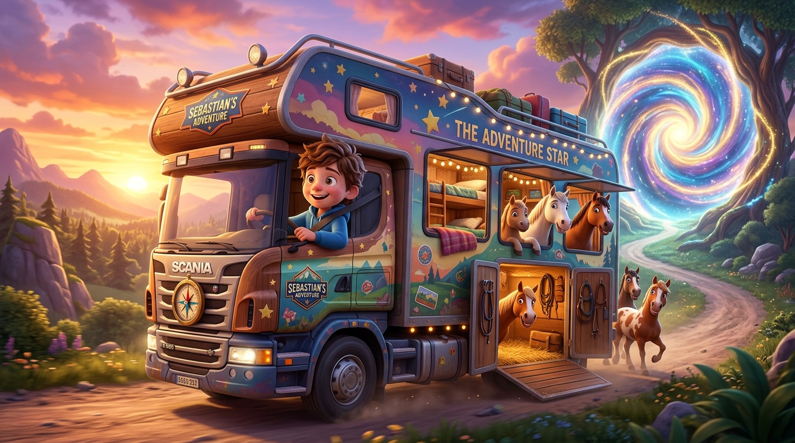
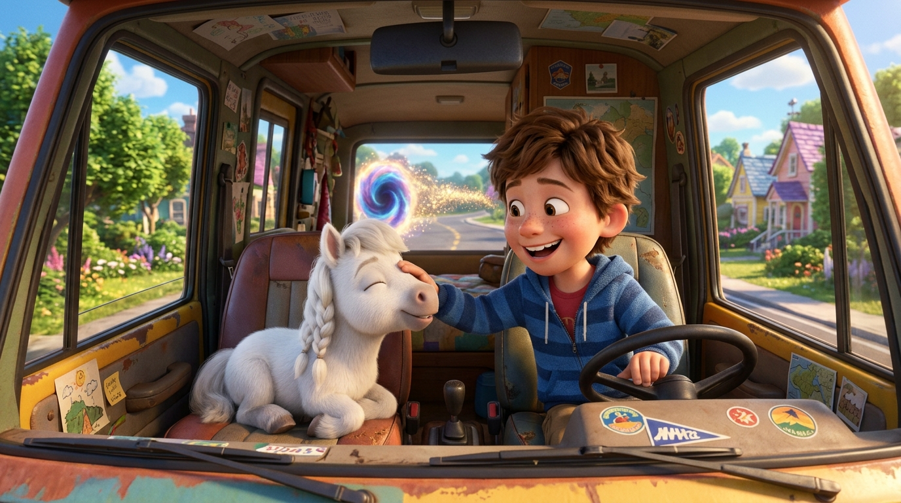

# 🐴🚛🌀 Sebastian, il Cavalletto Magico Marie e il Camion Camper dei Cavalli

> **Una storia originale inventata e raccontata a voce da Sebastian C. ("Seby", 6 anni, Primary 1) insieme a papà Riccardo.**  
> *Registrata l'8 Novembre 2026 a Zurigo.*

---

## 🎙️ Ascolta la Registrazione Vocale Originale

* **Formato MP3**: [audio_originale.mp3](audio_originale.mp3)
* **Formato OGG (Opus/Vorbis)**: [audio_originale.ogg](audio_originale.ogg)
* **Archivio audio globale**: `audio/sebastian/2026-11-08-storia-cavalletto-marie-mondo-cavalli.mp3`

---

## 📝 Sbobinatura Fedele (Audio Transcript)

Ecco la trascrizione integrale e fedele parola-per-parola del messaggio vocale registrato al microfono con papà Riccardo:

> **Papà Riccardo:**  
> «Ermete, abbiamo una storia per te da parte di Sebi da mettere nel film *Kids' Own Stories*, quindi sbobbina l'audio e pronto... vai Sebi, raccontaci!»  
>  
> **Sebastian:**  
> «Io ero come in un posto con un cavalletto e poi il cavalletto ha spuntato...»  
>  
> **Papà Riccardo:**  
> «Cavalletto vuol dire un piccolo cavallo?»  
>  
> **Sebastian:**  
> «Sì, ha sputato dell'aria che ha fatto un tunnel. L'ho passato e poi ho trovato un mondo dei cavalli, e poi lì ho trovato un camion dove potevo portare tutti i cavalli e ci potevo anche vivere. Ho passato il tunnel...»  
>  
> **Papà Riccardo:**  
> «Tipo un camion camper, diciamo, che porta i cavalli e ci vivi dentro?»  
>  
> **Sebastian:**  
> «Ok sì, ho passato il tunnel così con il camion e poi ero felice. E poi ho detto: ma poi il mio camion non era pieno, cioè mancava un cavallo! E poi il cavallo che ha fatto il tunnel l'ho preso, l'ho messo dentro, e poi l'ho fatto chiudere il tunnel... e poi ha chiuso il tunnel, e poi siamo felici per sempre!»  
>  
> **Papà Riccardo:**  
> «Fantastico! Come si chiama questo cavallo che ha fatto il tunnel e poi ha chiuso il tunnel?»  
>  
> **Sebastian:**  
> «Si chiama **Marie**! Marie come nome francese di Maria.»  
>  
> **Papà Riccardo:**  
> «E dimmi una cosa: cosa c'era dentro quel tunnel, come lo vedi quel tunnel?»  
>  
> **Sebastian:**  
> «È come un tunnel... come un vortice che lo passi e poi passi in un altro mondo.»  
>  
> **Papà Riccardo:**  
> «Ah, tipo un vortice dimensionale, una cosa fantasy! Wow, ok! E nell'altro mondo, parlami del mondo dei cavalli: cosa vedi nel mondo dei cavalli?»  
>  
> **Sebastian:**  
> «Quasi tutto è fatto di cavalli: le case, le giacche sono fatte di pelo di cavalli già morti... e loro potevano fare tutto quello che volevano! Ma poi anche nel mondo dei cavalli hanno voluto andare via nel mondo delle persone. E così sono andato nel camion e poi sono andate nel mondo umano.»  
>  
> **Papà Riccardo:**  
> «Ok perfetto, penso che ne abbiamo abbastanza. Grazie Sebi!»

---

## 📖 Il Racconto Illustrato (del Cantastorie)

### Capitolo 1: Il Piccolo Cavalletto Marie e il Soffio Magico

In una radura luminosa e piena di mistero, il piccolo **Sebastian** fece un incontro davvero speciale. Davanti a lui non c'era un cavallo qualsiasi, e nemmeno un cavalletto da disegno: c'era un delizioso **cavalletto**, ovvero un cavallino in miniatura, morbido, con la criniera bianca come la panna montata e gli zoccoli dorati. Il suo nome era **Marie**, pronunciato alla francese proprio come Maria!

Marie guardò Sebi con grandi occhi intelligenti, fece un respiro profondo e all'improvviso... *FROOOOSH!* Sputò dalla bocca una potente folata d'aria scintillante! Quell'aria fatata cominciò a girare vorticosamente fino a scavare nel vuoto un incredibile **tunnel dimensionale**, un vero e proprio vortice di luce e stelle pronto a spalancarsi verso l'ignoto!

---

### Capitolo 2: Il Vortice Dimensionale e il Fantastico Mondo dei Cavalli

Senza alcuna paura, guidato dalla sua grande curiosità, Sebi si tuffò nel tunnel vorticoso. Attraversò scie di comete e sfumature color pastello finché non mise piede dall'altra parte: era arrivato nel leggendario **Mondo dei Cavalli**!

Era un reame strabiliante dove ogni cosa parlava di cavalli: le graziose casette avevano le porte a forma di ferro di cavallo, i prati di trifoglio brillavano sotto un cielo violetto e persino le giacche degli abitanti erano tessute con il morbido pelo dei cavalli saggi dei tempi andati. In quella terra incantata, i cavalli erano liberi e felici di fare tutto ciò che desideravano da mattina a sera. Eppure, ascoltando i racconti di Sebi, un grande desiderio nacque nei loro cuori: desideravano scoprire e visitare il magico **mondo degli umani**!

---

### Capitolo 3: Il Grande Camion Camper e la Partenza per la Terra

Proprio quando i cavalli si chiedevano come fare per attraversare il vortice tutti insieme, Sebi scorse parcheggiato tra le colline un veicolo monumentale e fiammante: un gigantesco **Camion Camper**! Era una meraviglia a motore, dotata di una cabina con comodi letti e cucina per viverci dentro, e sul retro un immenso rimorchio panoramico attrezzato con stalle soffici e finestrini spalancati.

«Tutti a bordo! C'è posto per tutti nel mio camion camper!» gridò Sebi saltando al volante come un vero camionista. Con nitriti allegri e zoccoli che battevano a tempo, tutti i cavalli del reame salirono festanti a bordo. Sebi ingranò la marcia, accese i fari fendinebbia e guidò a tutto gas dritto verso il tunnel dimensionale!

---

### Capitolo 4: Marie sale a Bordo e il Portale si Chiude per Sempre

Mentre il camion camper rombava dentro il tunnel di luce, Sebi diede un'occhiata allo specchietto retrovisore. «Un momento... il camion non è ancora pieno! Manca il passeggero più importante di tutti!» esclamò. All'imbocco del vortice c'era rimasto **Marie**, il piccolo cavalletto che aveva soffiato il portale!

Sebi frenò di colpo, aprì la portiera della cabina e con un gran sorriso fece saltare Marie sul sedile del passeggero accanto a sé. Subito dopo, Marie diede un ultimo soffio fatato: il tunnel dimensionale alle loro spalle si richiuse in una cascata di scintillanti stelline d'oro, sigillando il passaggio. Il grande camion camper sbucò sull'asfalto del mondo delle persone sotto un sole splendente. Da quel giorno in poi, Sebi, Marie e tutti i cavalli rimasero insieme, liberi, felici e inseparabili per sempre!
