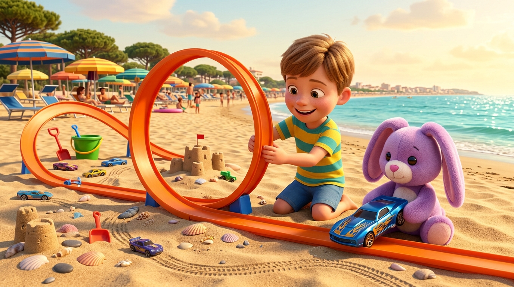
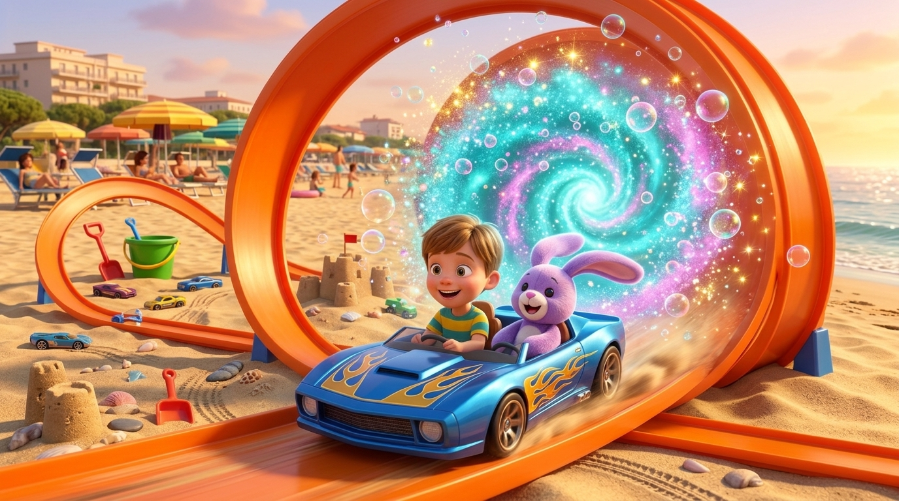
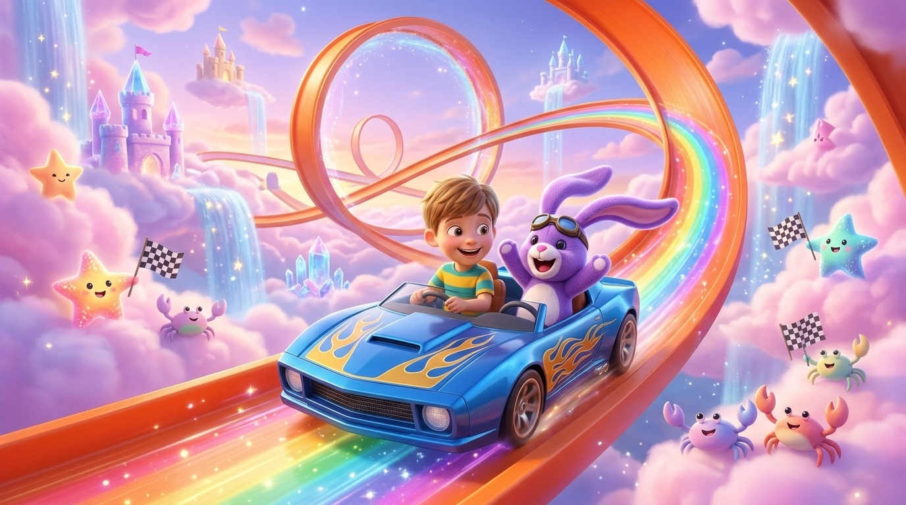
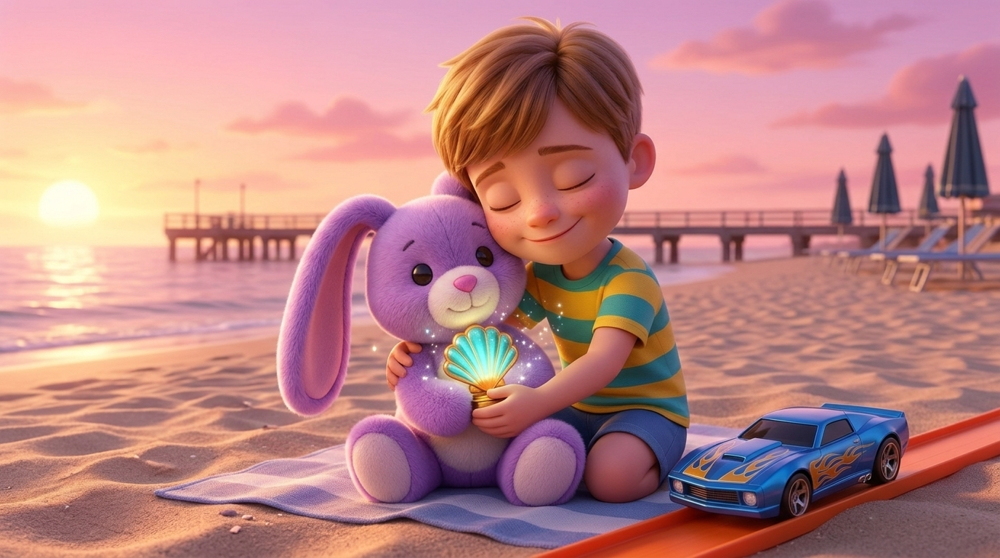

# 🐰🏎️🌈 Seby, il Dolce Pupurabbu e la Pista Fatata delle Hot Wheels a Lido degli Estensi

> **Una storia originale dedicata a Sebastian C. ("Seby", 6 anni, Primary 1) e raccontata al microfono con papà Riccardo.**  
> *Registrata il 7 Novembre 2026 (ambientata tra Lido degli Estensi e il Mondo Magico).*

---

## 🎙️ Ascolta la Storia Registrata al Microfono

* **Formato MP3**: [audio_originale.mp3](audio_originale.mp3)
* **Formato OGG (Opus/Vorbis)**: [audio_originale.ogg](audio_originale.ogg)
* **Audiolibro Narrato (🇮🇹 Italiano + Piano)**: [narrated_it.mp3](narrated_it.mp3)
* **Narrated Audiobook (🇬🇧 English + Piano)**: [narrated_en.mp3](narrated_en.mp3)
* **Archivio audio globale**: `audio/sebastian/2026-11-07-storia-pupurabbu-hot-wheels-lido-degli-estensi.mp3`

---

## 📝 Sbobinatura Fedele (Audio Transcript)

Ecco la trascrizione integrale parola-per-parola del messaggio vocale registrato dal browser (`+ Nuova Storia`) e allegato alla GitHub Issue #1:

> **Papà Riccardo *(on behalf of Sebastian)*:**  
> «Allora, questo è Papino che parla *on behalf of* Sebastian.  
> Allora, Seby adora il suo amico **Pupurabbu**, che è un pupazzo viola di peluche, e adora le... come si chiamano le macchinine... le **Hot Wheels**!  
> Quindi una qualunque storia *(sbadiglio)* che abbia a che fare con le Hot Wheels, e magari ambientata a **Lido degli Estensi**, ehm... con il Pupurabbu e magari un **portale fatato** che ti porta in un mondo... in un mondo diverso, pieno di magia, sarebbe molto figo.  
> E anche molto *cutie*, perché Seby comunque ha sei anni, quindi ancora ama i pupazzi, quindi qualcosa del genere.  
> Questi sono gli ingredienti che mi piacerebbe vedere. Grazie!»

---

## 📖 Il Racconto Illustrato (del Cantastorie)

### Capitolo 1: La Grande Pista sulla Spiaggia di Lido degli Estensi

C'era una volta, in un caldo pomeriggio d'estate sulla spiaggia dorata di **Lido degli Estensi**, il piccolo **Sebastian** — che tutti chiamavano affettuosamente **Seby** — intento a preparare la gara più straordinaria del mondo. Tra gli ombrelloni colorati, il profumo dei pini marittimi e le onde azzurre del mare Adriatico che facevano *ciac-ciac* sulla riva, Seby aveva costruito con la sabbia e i binari arancioni una pista delle **Hot Wheels** lunghissima, piena di curve paraboliche, ponti di conchiglie e un gigantesco giro della morte!

Accanto a lui, seduto su un morbido telo da mare come un vero direttore di gara, c'era il suo amico più caro e inseparabile: **Pupurabbu**, un dolcissimo coniglietto di peluche tutto viola, con due lunghe orecchie vellutate color lavanda, il nasino rosa cucito a mano e la pancia soffice perfetta per le coccole.

Seby aveva sei anni e voleva un bene immenso al suo tenero Pupurabbu: non iniziava mai nessuna avventura senza di lui! Tra le zampine morbide del pupazzo viola brillava la macchinina Hot Wheels preferita di Seby, un bolide blu elettrico decorato con fiammelle dorate, pronto a sfrecciare sotto il sole della riviera.

---

### Capitolo 2: Il Giro della Morte e il Portale Fatato

«Sei pronto, Pupurabbu? Tre, due, uno... **VIA!**» esclamò Seby premendo con entusiasmo il pulsante del lanciatore. La macchinina blu sfrecciò come un piccolo fulmine lungo la pista arancione, sollevando una scia di granelli d'oro fino a imboccare a tutta velocità il grande giro della morte in riva al mare.

Ma proprio quando il bolide raggiunse la cima del cerchio arancione, accadde qualcosa di meraviglioso: le conchiglie intorno alla pista iniziarono a suonare una melodia cristallina e, proprio al centro del loop, si spalancò un **portale fatato**! Era un vortice incantevole di luce turchese, stelline dorate e bolle di sapone iridescenti che profumavano di zucchero filato e brezza marina.

In quell'istante una scintilla fatata sfiorò le lunghe orecchie viola di Pupurabbu: il peluche sbatté gli occhietti dolci, fece un saltello morbido sulla sabbia e sorrise a Seby prendendolo per mano! Come per incanto, la macchinina Hot Wheels divenne abbastanza grande per tutti e due: Seby e il suo soffice amico viola balzarono a bordo e... *ZOOOOM!* Sfrecciarono insieme dentro il portale fatato!

---

### Capitolo 3: A Tutto Gas nel Mondo Magico delle Nuvole

Usciti dal tunnel di stelle, Seby e Pupurabbu si ritrovarono in un mondo diverso, dolcissimo e pieno di magia! Lassù non c'era l'asfalto, ma chilometriche piste arancioni e arcobaleno sospese tra soffici nuvole di zucchero filato rosa, cascate di polvere di stelle e grandiosi castelli di sabbia fatti di cristallo luminoso che fluttuavano nel cielo.

Seduto sul sedile del copilota con un paio di buffi occhialoni da corsa appoggiati sulla fronte di peluche, Pupurabbu batteva le zampine viola per la gioia, mentre le sue lunghe orecchie morbide svolazzavano nel vento tiepido facendo il solletico a Seby che rideva a crepapelle.

A ogni curva parabolica la loro Hot Wheels lasciava dietro di sé una scia di arcobaleni e bollicine luminose, mentre a bordo pista una squadra di tenerissime stelline marine dorate e granchietti color pastello sventolava bandierine a scacchi facendo il tifo per Seby e il suo amico del cuore!

---

### Capitolo 4: La Conchiglia delle Stelle e le Coccole al Tramonto

Dopo un ultimo salto spettacolare sopra il grande ponte dell'arcobaleno, Seby e Pupurabbu tagliarono il traguardo tra una pioggia di coriandoli di luce! Per premiare la loro amicizia speciale, le stelline del regno fatato posarono tra le zampine di Pupurabbu una piccola **Conchiglia-Trofeo** d'oro e turchese che brillava come una lanterna.

Poi il portale fatato si aprì di nuovo con una dolce carezza di luce e, lungo uno scivolo vellutato, riportò la macchinina giù sulla spiaggia di Lido degli Estensi, proprio mentre il sole tramontava dietro il pontile tingendo il mare di rosa, arancione e violetto.

Sulla sabbia tiepida del tramonto, Pupurabbu era tornato a essere il tenero pupazzo di peluche viola di sempre, ma tra le sue zampine di stoffa stringeva davvero la conchiglia luminosa del mondo magico! Seby sorrise con gli occhi pieni di meraviglia e abbracciò forte forte il suo morbido Pupurabbu, pronto a raccontare tutta l'avventura a Papino.

---

## 🎬 Il Video Ufficiale

* **File MP4**: [video_pupurabbu_hotwheels.mp4](video_pupurabbu_hotwheels.mp4)

## 🌐 Pagina Web Interattiva
È disponibile la versione sfogliabile con audiolibro IT/EN e voce originale in:
* **HTML**: [index.html](index.html)
